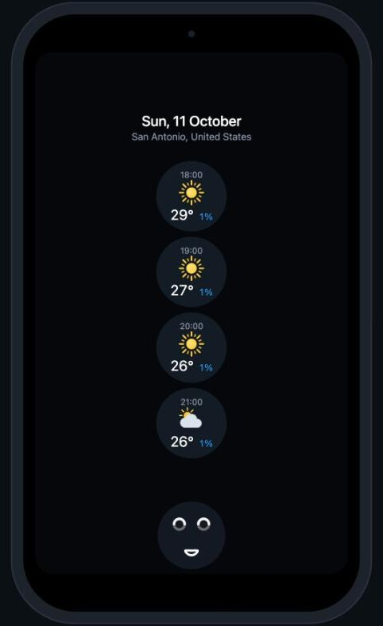

# ovos-visage

[](https://github.com/OscillateLabsLLC/.github/blob/main/SUPPORT_STATUS.md)
[](https://github.com/OscillateLabsLLC/ovos-visage/actions/workflows/unit_tests.yml)

<p align="center">
  
</p>

A browser GUI client for [OpenVoiceOS](https://openvoiceos.org) in the style of the 2018
Mycroft Mark II Kickstarter concept: a tall portrait screen, big circular widgets, and a
face that listens, thinks and speaks with a viseme-driven mouth. Mycroft never shipped
that design; this is a new thing built on the idea. It connects to a stock `ovos-gui`
service as a GUI client, so no OVOS code is modified, and it renders the homescreen, the
system templates, and the weather, date-time, alerts and OCP media pages. Any other skill
page shows as a debug card with its namespace, page name and session data.

```
ovos-core ──core bus 8181──▶ ovos-gui-service ──GUI ws 18181──▶ ovos-visage ──/ws──▶ browser (480x800 portrait)
skills, homescreen                                   ▲ ovos.widgets.* translation on the core bus
```

## Requirements

- A running OVOS install (core bus on `ws://127.0.0.1:8181/core`) with the weather,
  date-time, alerts and OCP skills you want to see.
- Python 3.11+ for ovos-visage itself.
- A **separate virtualenv** for `ovos-gui` and `ovos-skill-homescreen`. The homescreen
  pins `ovos-workshop<9`; installing it next to OVOS can downgrade `ovos-workshop` there
  and break OVOS (`docs/SPEC.md` 3.1).
- Node.js only to run the browser-side unit tests.

## Install

```bash
uv tool install git+https://github.com/OscillateLabsLLC/ovos-visage
# or
pip install git+https://github.com/OscillateLabsLLC/ovos-visage
```

The GUI service and the homescreen go in their own virtualenv (`<gui-venv>` below).
OVOS alpha installs export pip and uv constraint files that conflict with the
homescreen, so unset them for this one install:

```bash
python3 -m venv <gui-venv>
env -u VIRTUAL_ENV -u PIP_CONSTRAINT -u UV_CONSTRAINT \
  <gui-venv>/bin/pip install --pre ovos-gui ovos-workshop ovos-skill-homescreen
```

## Running

Three processes besides OVOS itself:

```bash
<gui-venv>/bin/ovos-gui-service
<gui-venv>/bin/ovos-skill-launcher ovos-skill-homescreen.openvoiceos
ovos-visage -v          # then open http://127.0.0.1:8766
```

Size the browser window tall, or let the page scale the 480 × 800 screen to fit. To try
it without a microphone, inject an utterance on the core bus:

```bash
<gui-venv>/bin/python docs/spike_say.py "what time is it"
```

Options: `--host`, `--http-port` (8766), `--bus` (`ws://127.0.0.1:8181/core`), `--gui-id`,
`--cache-dir` (`~/.cache/ovos_gui`, served at `/res/`), `--record FILE.jsonl` (append
every GUI message, for new test fixtures), `-v`.

## How it works

- **Seam.** `gui_client.py` sends `mycroft.gui.connected` with `framework: html` on the
  core bus, gets the port from `mycroft.gui.port`, opens the GUI socket and announces
  again on it. Without the second announcement `ovos-gui` treats the socket as `qt5` and
  sends QML paths. Pages arrive as `{"url": null, "page": "time"}`.
- **State.** `state.py` mirrors namespaces, pages, session data and the active-skill
  stack. `static/mirror.js` is the same model in the browser. The browser gets a full
  snapshot on connect, then the GUI protocol messages themselves as deltas. A test
  replays the recorded fixtures through both and requires identical state.
- **Widgets.** `widgets.py` is a port of the shell companion's WidgetManager. With the
  `generic` gui extension nobody translates the alerts skill's `ovos.widgets.update`
  into the typed messages the homescreen listens for, so this client does.
- **Resources.** Session values that are paths in `~/.cache/ovos_gui` become `/res/...`
  URLs, and `/res/` serves nothing outside that directory. Images that OCP sends as
  absolute paths elsewhere are served only when that exact path appeared in session
  data, under an opaque `/res-abs/<token>` URL.
- **Pages.** One JS module per page, routed by `namespace/page` (system templates by page
  name alone), with pure view models tested under node. The visual rules are circles,
  rings and plain text on black, with no cards or panels (`docs/SPEC.md` 9).

`docs/SPEC.md` is the design and protocol reference. `docs/NOTES.md` has what was
measured about each skill, and `docs/UPSTREAM_ISSUES.md` the upstream bugs found.

## The face

`static/face/` draws the Kickstarter concept face: two ring eyes (grey, with a white arc
over the top half) and a white mouth, in the upper half of the screen. The same component
is the `SYSTEM_Face` page and the attention overlay, shown from listening to about a
second after speech ends. Over idle and `SYSTEM_Face` the overlay is the full face on a
dimmed screen; over any other page it shrinks to a 104 px round badge at the bottom
centre and the page stays visible.

The geometry is `VISAGE_FACE` in `static/face/face.js`. Eyes, strokes and the rest smile
are measured from Mycroft's animated face image. The face is deliberately rounder than
that reference, with the eyes 260 px apart and the mouth lower, and the open mouth
shapes are hollow outlines rather than filled (`docs/screenshots/face/`).

The mouth has seven outlines, one per Mycroft viseme code, all with the same point count,
and eases between them. The codes come from `ovos_utils/lang/visimes.py`; the shapes
redraw the Mark 1 firmware's `MOUTH_VISEMES` bitmaps:

| code | phonemes (ovos_utils) | shape |
|---|---|---|
| 0 | ae eh ey ah ih y iy aa ay ax hh | wide open, flat top |
| 1 | aw | small tall oval |
| 2 | uh w uw er r ow | rounded O |
| 3 | th dh zh ch sh jh z s n t d l g ng k | half open |
| 4 | b p m, pause, unknown | closed smile (rest) |
| 5 | v f | narrow lens |
| 6 | oy ao | tiny oval |

`enclosure.mouth.viseme_list` pairs are `[code, cumulative end time]`. The browser anchors
the list to `performance.now()` when it arrives, which assumes ovos-audio runs on the same
machine. Browsers throttle hidden tabs, so the mouth only keeps time in a visible tab.

## Trying every screen

With the stack running:

```bash
uv run python tests/manual/demo.py                 # a tour of every screen, about 4.5 minutes
uv run python tests/manual/demo.py --list          # step names; pass one or more to run only those
uv run python tests/manual/demo.py --pace 2        # every dwell twice as long, for a recording
uv run python tests/manual/show_templates.py       # every SYSTEM_* template with sample data
uv run python tests/manual/replay_visemes.py       # a recorded viseme list, no TTS
uv run python tests/manual/show_face.py --sleeping
```

The demo waits for each page rather than sleeping, prints what to look at, and cleans up
the timers, alarms and pages it created, even on Ctrl-C. `alarm-ring` is opt-in because
it waits for an alarm to go off. Step details are in `docs/NOTES.md`; screenshots of
every page are in `docs/screenshots/`.

## Third-party code

`ovos_visage/static/vendor/lottie_light.min.js` is lottie-web 5.13.0 (MIT,
`static/vendor/lottie-web.LICENSE.md`), copied unmodified from the npm package
`lottie-web@5.13.0` (`build/player/lottie_light.min.js`, tarball sha512 matching the
registry's `dist.integrity`). It is the svg-only build without expression support; none
of the installed OVOS animations use expressions. It is served locally, so no CDN is
needed at runtime. Loading, Status and OCP's busy page play OVOS's own Lottie files from
the ovos-gui cache through `static/lottie.js`.

## Development

```bash
git clone https://github.com/OscillateLabsLLC/ovos-visage
cd ovos-visage
just sync      # uv sync --extra test
just test      # pytest with coverage; the mirror parity and page model tests need node
just lint
just run -v
```

See `CONTRIBUTING.md`.

## License

Apache 2.0
